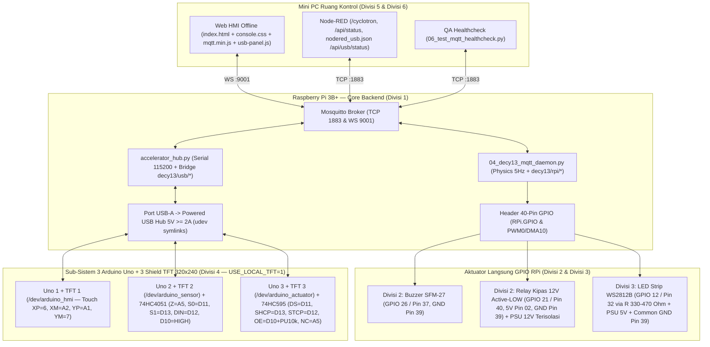

# ⚛️ Proyek Alat Peraga Siklotron DECY-13 (13 MeV H⁻)

**Politeknik Teknologi Nuklir Indonesia (BRIN) — Arsitektur Kolaborasi 6 Divisi (Multi-AI & GitHub)**

Selamat datang di repositori proyek **DECY-13**. Proyek ini menggunakan sistem **MQTT State-Driven** dengan **Raspberry Pi 3 Model B+** sebagai otak perangkat keras (*Core Backend*) dan **Mini PC** sebagai layar kendali *Web HMI*.

---

## 🚀 WAJIB BACA PERTAMA KALI (Untuk Anggota Tim Baru / Awam GitHub)

Sebelum menyentuh kode atau menjalankan AI, **buka 3 file panduan ini secara berurutan** di laptopmu:

1. **📄 Ringkasan Awal:** Buka file [`BACA_INI_DULU.txt`](BACA_INI_DULU.txt)
2. **🐙 Panduan GitHub Pemula & Ambil Prompt AI Divisimu (PENTING!):**
   Buka file [`instruksi untuk projek sp/PANDUAN_GITHUB_DAN_TIM_AI.html`](instruksi%20untuk%20projek%20sp/PANDUAN_GITHUB_DAN_TIM_AI.html) dengan **Google Chrome / Microsoft Edge** (di GitHub web file HTML tampil berupa kode, jadi **download/clone dulu ke laptopmu** lalu klik kanan → *Open with Chrome*).
3. **⚡ Panduan Cara Kerja & Wiring Alat:**
   Buka file [`instruksi untuk projek sp/PANDUAN_VISUAL.html`](instruksi%20untuk%20projek%20sp/PANDUAN_VISUAL.html) dengan **Google Chrome / Microsoft Edge**.
4. **🖥️ Panduan Stasiun Uji Mini PC Ruang Kontrol (Windows 8/10/11 <-> Raspi):**
   Buka [`decy13_mqtt_kit/PANDUAN_MINI_PC_UJI_LAPANGAN.md`](decy13_mqtt_kit/PANDUAN_MINI_PC_UJI_LAPANGAN.md) untuk setting koneksi Mini PC Win 8 <-> Raspberry Pi, urutan uji lapangan terbaru, dan **Prompt AGY Mini PC siap *copy-paste***.
5. **🔌 Panduan Operasional Lengkap Pasca-Wiring (100% Wi-Fi Auto-Link — Siap Baca di GitHub/HP):**
   Buka [`PANDUAN_OPERASIONAL_PASCA_WIRING.md`](PANDUAN_OPERASIONAL_PASCA_WIRING.md) untuk cek keselamatan wiring, urutan nyalakan listrik, operasional `minipc_control_hub.py`, uji 6 divisi serentak, & *shutdown* aman.
6. **🤖 Handoff Konteks Antigravity (AGY) Mini PC (`AGENTS.md` + `HANDOFF_ANTIGRAVITY_MINI_PC.md`):**
   Buka [`HANDOFF_ANTIGRAVITY_MINI_PC.md`](HANDOFF_ANTIGRAVITY_MINI_PC.md) untuk langsung melanjutkan sesi koordinasi Antigravity di Mini PC setelah `git pull` *(otomatis terdeteksi oleh [`AGENTS.md`](AGENTS.md))*.

> 🛡️ **ATURAN WAJIB KOLABORASI MANDIRI:**
> 1. AI milikmu (ChatGPT / Claude / Cursor / Gemini) **HANYA** membantu menulis isi file milik divisimu.
> 2. **DILARANG** menyuruh AI menjalankan `git commit` atau `git push` secara otomatis — **setiap anggota wajib melakukan `branch`, `pull`, `commit`, dan `push` sendiri** agar paham alur GitHub.
> 3. **DILARANG** mengedit file milik divisi lain agar tidak bentrok (*Merge Conflict*).

---

## 📢 Papan Pengumuman & Update Terbaru (`main`)

| Info | Keterangan |
| :--- | :--- |
| **Versi / Status `main`** | **`v1.6` (`18c2603`) — Progres Kartu Terverifikasi `54,2%` (`26/48`) • Uji Fisik 448 LED + Buzzer `GPIO 17` Divisi 3 (`0db6f3b`/`18c2603`), Integrasi 3-LCD TFT Arduino Uno (`207ac04`), Web HMI Offline (`usb-panel.js`), QA Handover Divisi 6 (`087e0fb`), & Safe-Pull Anti-Rusak Aktif!** |
| **Pengumuman Ketua** | 1. **Update Besar Integrasi (`v1.6` @ `18c2603`+):** Paket QA Divisi 6 (`087e0fb` / `d929400`: `300/300 ONLINE @ 4.99 Hz`), Web HMI Offline Divisi 5 (`6d3f8f5` + `assets/usb-panel.js`), **Integrasi 3-LCD TFT + 3 Arduino Uno USB** Divisi 4 (`AKSEL-DECY13/` patch `207ac04`), **Update Uji Isolasi 448 LED + Buzzer `GPIO 17`** Divisi 3 (`18c2603`), serta **`config_hardware.json` 448 LED (`brightness=15`) + `tools/minipc_control_hub.py` 100% Wi-Fi Auto-Link** kini resmi aktif di `main` dengan **0 tabrakan pin I/O**.<br>2. **PENTING — Sistem Safe-Pull Anti-Rusak (`tools/aman_pull_dan_sync.py`):** Sebelum `pull` atau lanjut kerja di branch divisimu, **WAJIB** jalankan `python tools/aman_pull_dan_sync.py --divisi <1..6>`. Skrip ini mem-backup file lokal & membuat branch cadangan, mengkarantina file luar divisi, lalu me-merge `origin/main` **tanpa menimpa pekerjaan lokalmu**!<br>3. **Update Divisi 3 (`0db6f3b` / `18c2603` — 448 LED + 9 Tes):** Jumlah LED fisik terkonfirmasi **448 WS2812B** (`0..399` spiral 400 LED, `400..447` beam/shoot 48 LED, ceklis `10/10`) dan **`config_hardware.json` sudah disinkronkan ke 448 LED (`brightness: 15`)**. Tinggal tempel bukti uji serentak bersama daemon asli + Mini PC + LCD untuk naik ke `LULUS_UJI_FISIK`.<br>4. **Siap Setup Penuh ke Mini PC Ruang Kontrol:** Ikuti [`PANDUAN_OPERASIONAL_PASCA_WIRING.md`](PANDUAN_OPERASIONAL_PASCA_WIRING.md) atau bagian [**Alur Lengkap Full Setup Mini PC**](#-alur-lengkap-full-setup--operasional-ke-mini-pc-ruang-kontrol-v16) di bawah (mode **100% Wi-Fi Auto-Link** lewat `python tools/minipc_control_hub.py`, `decy13.service`, & `decy13-usb-hub.service`). **Divisi 4 & Divisi 5:** tarik `main` lewat `aman_pull_dan_sync.py`, lalu lengkapi kartu ceklis masing-masing. |
| **Cara Tarik Update Aman (WAJIB)** | **Seluruh Anggota (Windows / Linux / RPi):**<br>`python tools/aman_pull_dan_sync.py --divisi <1..6>` *(untuk cek simulasi aman dulu tambah `--dry-run`; untuk memulihkan versi sebelum pull gunakan `--restore-latest`)*<br>*(Khusus Mini PC / RPi baca-saja tanpa edit lokal: `git checkout main && git pull origin main`)* |

---

## 📊 Progres Nyata Proyek & Tabel Rapor 6 Divisi

> **📈 Posisi Progres Nyata Proyek Saat Ini (Terukur dari 6 Kartu [`laporan_uji/`](laporan_uji/README.md)):**
> - **Progres Total Terverifikasi (`Tahap A + Tahap B`):** **`54,2%` (`26 / 48` butir ceklis)** `[█████░░░░░]` *(naik dari `43,8%` pasca-integrasi ceklis `5/5` Tahap B 448 LED Divisi 3 `f6c367d`)*
> - **Tahap A — Kesiapan Kode & Simulasi Laptop:** **`63,6%` (`14 / 22` butir)** *(Divisi 1, 2, 3, 6 sudah `100%` Tahap A; Divisi 4 & 5 tinggal verifikasi kartu)*
> - **Tahap B — Uji Fisik Alat Nyata (RPi 3B+ & Mini PC):** **`46,2%` (`12 / 26` butir)** *(Divisi 2 `4/4` `LULUS_UJI_FISIK`; Divisi 3 `5/5` uji fisik 448 LED `f6c367d` / `18c2603`; Divisi 1 `3/5` bare-board Core RPi)*
>
> **🧭 Posisi Milestone (`M1` s.d. `M5` — lihat [`JOBDESK_DAN_DOD.md`](laporan_uji/JOBDESK_DAN_DOD.md)):**
> - **M1** *(Bootstrap, Preflight & Bare-Board RPi)*: ✅ **Tercapai di unit `sp-aksel`** (`4.97 Hz`, 0 packet drop; Powered USB Hub 5V >=2A disiapkan untuk 3 Uno TFT)
> - **M2** *(Uji Isolasi Fisik Aktuator `01`, `02`, `03` & 3-TFT USB)*: 🔄 **~67%** *(Divisi 2 `01_test_relay_buzzer.py` & aktuator `LULUS_UJI_FISIK`; Divisi 3 `03_test_led_pixel_finder.py` 448 LED `5/5` Tahap B; 3-TFT Uno Divisi 4 terintegrasi & siap uji berpasangan)*
> - **M3** *(Integrasi Penuh Daemon + Divisi 2, 3, & 4 serentak di RPi)*: ⏳ **0%** *(siap dijadwalkan di RPi + Mini PC — tinggal finalisasi `config_hardware.json` 64→448 LED & verifikasi kartu Divisi 4)*
> - **M4** *(Integrasi Mini PC Web HMI Offline & QA Healthcheck)*: 🔄 **~50%** *(Web HMI offline + `usb-panel.js` aktif; QA Divisi 6 `300/300 ONLINE @ 4.99 Hz` simulator PC↔RPi sudah di-merge; sisa setup penuh ke Mini PC + `04_decy13_mqtt_daemon.py` asli)*
> - **M5** *(Commissioning Final & 6/6 Kartu `LULUS_UJI_FISIK`)*: ⏳ **0%** *(1/6 kartu berstatus `LULUS_UJI_FISIK`: Divisi 2; Divisi 3 sudah `10/10` ceklis menunggu konfirmasi final integrasi daemon & LCD)*

Setiap anggota yang melakukan `git push` akan diperiksa oleh **Satpam Otomatis (GitHub Actions)** (tanda ✅/❌) dan direview oleh Ketua sebelum di-*merge* ke `main`.

| Divisi | Penanggung Jawab | Branch Wajib | File Eksklusif (Boleh Diedit) | Status Audit Kode / CI | Status Uji Hardware RPi & Progres Kartu |
| :--- | :--- | :--- | :--- | :--- | :--- |
| **Divisi 1 (Ketua)** | `azfaaksan-hub` | `main` / `core-raspi-backend` | `04_decy13_mqtt_daemon.py`, `05_laptop_dryrun_simulator.py`, `config_hardware.json`, `modules/base_module.py`, `tools/*`, `laporan_uji/UJI_DIVISI_1_CORE_RASPI.md` | ✅ **Core Aktif `v1.6`** *(`setpoint_limits`, `connect_async`, `SIGTERM`, safe-pull `aman_pull_dan_sync.py` siap)* | 🟡 [`DRAFT_PUSH_LAPTOP`](laporan_uji/UJI_DIVISI_1_CORE_RASPI.md) **`75%` (`6/8`)** *(3/3 Laptop, **3/5 RPi bare-board** `192.168.137.66`)* |
| **Divisi 2** | `dzakimumtazi` | `divisi-2-vacum-safety` | `decy13_mqtt_kit/raspi_cli/modules/mod_vacuum_safety.py`, `01_test_relay_buzzer.py`, `laporan_uji/UJI_DIVISI_2_VAKUM_SAFETY.md` | ✅ **Merged ke `main`** *(siap integrasi M3)* | 🟢 [`LULUS_UJI_FISIK`](laporan_uji/UJI_DIVISI_2_VAKUM_SAFETY.md) **`100%` (`7/7`)** *(3/3 Laptop, **4/4 RPi fisik** bersama tim; E-Stop via Web HMI HTML — tanpa saklar fisik `GPIO 22`)* |
| **Divisi 3** | `blufiaa` | `divisi-3-uji-fisik` / `divisi-3-led-ws2812b-v13` | `decy13_mqtt_kit/raspi_cli/modules/mod_led_ws2812b.py`, `03_test_led_pixel_finder.py`, `laporan_uji/UJI_DIVISI_3_LED_WS2812B.md` | ✅ **Update `18c2603` + JSON 448 LED Aktif** *(448 LED `brightness=15` di `config_hardware.json` + 9 uji & buzzer `GPIO 17`; `aman_pull_dan_sync.py --divisi 3`)* | 🟡 [`DRAFT_PUSH_LAPTOP`](laporan_uji/UJI_DIVISI_3_LED_WS2812B.md) **`100%` (`10/10`)** *(5/5 Laptop, **5/5 RPi 448 LED**; tunggu bukti log uji serentak daemon & 3-LCD)* |
| **Divisi 4** | `HDMrishiki` | `divisi-4-tft` *(atau `divisi-4-lcd-ili9341`)* | `AKSEL-DECY13/README.md`, `AKSEL-DECY13/raspi/*`, `AKSEL-DECY13/firmware/*`, `mod_lcd_ili9341.py`, `02_test_lcd_ili9341.py`, `laporan_uji/UJI_DIVISI_4_LCD_ILI9341.md` | ✅ **Kode 3-TFT USB Terintegrasi ke `main`** *(`207ac04` — jalankan `aman_pull_dan_sync.py --divisi 4`)* | ⏳ [`BELUM_MULAI`](laporan_uji/UJI_DIVISI_4_LCD_ILI9341.md) **`0%` (`0/8`)** *(Kode 3-Uno TFT + `74HC4051`/`74HC595` sudah masuk; tinggal isi kartu & bukti uji fisik)* |
| **Divisi 5** | `HDMrishiki` | `divisi-5-web-hmi` | `decy13_mqtt_kit/web_hmi/index.html`, `decy13_mqtt_kit/web_hmi/assets/*`, `laporan_uji/UJI_DIVISI_5_WEB_HMI.md` | ✅ **Web HMI Offline + `usb-panel.js` Aktif di `main`** *(`6d37d99` + integrasi `207ac04`)* | ⏳ [`BELUM_MULAI`](laporan_uji/UJI_DIVISI_5_WEB_HMI.md) **`0%` (`0/8`)** *(Tinggal jalankan `aman_pull_dan_sync.py --divisi 5`, cek offline DevTools, & isi kartu)* |
| **Divisi 6** | `rekypurnomo` | `divisi-6-mqtt-nodered-qa-testing` | `06_test_mqtt_healthcheck.py`, `tests/decy13_simulator_divisi6.py`, `flows_mqtt_decy13.json`, `qa_divisi6/*`, `CHECKLIST_COMMISSIONING.txt`, `laporan_uji/UJI_DIVISI_6_MQTT_QA.md` | ✅ **Merged ke `main`** *(`087e0fb` / `d929400`: QA `300/300 ONLINE @ 4.99 Hz` simulator PC↔RPi 3)* | 🟡 [`DRAFT_PUSH_LAPTOP`](laporan_uji/UJI_DIVISI_6_MQTT_QA.md) **`42,9%` (`3/7`)** *(3/3 Laptop — uji simulator PC↔RPi 3 selesai; sisa uji `04_decy13_mqtt_daemon.py` asli + alat nyata)* |

### 🧪 Aturan "Push Dulu" vs "Lulus Uji Raspi" (`laporan_uji/`)
Supaya tidak pernah terjadi *Merge Conflict* dan kita bisa tahu dengan jujur apakah kode teman yang baru di-push sudah dites di alat nyata atau masih ada bug:
1. **Jangan edit `README.md` ini dari branch divisi!** Anggota + AI-nya cukup mengisi **1 file kartu ceklis milik divisinya sendiri** di folder [`laporan_uji/`](laporan_uji/README.md).
2. **Kalau Ketua bilang "Push dulu progresmu" saat alat/kode belum 100% beres:**
   - Isi `Status Push Saat Ini` dengan **`DRAFT_PUSH_LAPTOP`** *(baru lolos simulasi laptop)* atau **`SEDANG_REVISI_HARDWARE`** *(masih ada bug/kendala saat diuji)*.
   - Centang **`[x]` pada Tahap A (Laptop)** saja jika sudah lolos, dan tulis detail masalah yang masih terjadi di **Bagian C** agar terbaca oleh Ketua dan sesi AI berikutnya.
3. **Aturan Keras AI:** AI **DILARANG** mencentang **`[x]` pada Tahap B (Uji Fisik RPi)** atau menulis **`LULUS_UJI_FISIK`** sebelum anggota menempelkan bukti hasil tes nyata dari Raspberry Pi 3B+ / Mini PC! (*Alat `cek_integrasi_dan_announcer.py --ci` otomatis menolak status `LULUS_UJI_FISIK` jika kotak Tahap A/B masih ada yang kosong.*)

---

## 📝 Catatan Penyelarasan & Rencana Uji Berikutnya

### 🛡️ Sistem Safe-Pull Anti-Rusak (`tools/aman_pull_dan_sync.py`)
Agar proses `pull` dari `main` **tidak pernah menimpa file yang sudah anggota kerjakan** (atau bentrok di file divisi lain), gunakan perintah ini **setiap kali sebelum mengedit/push**:
```bash
# Simulasi aman dulu (opsional):
python tools/aman_pull_dan_sync.py --divisi <1..6> --dry-run

# Tarik update origin/main dengan proteksi otomatis file divisi:
python tools/aman_pull_dan_sync.py --divisi <1..6>
```
Yang dilakukan skrip secara otomatis:
1. Menyalin semua file divisimu + file yang sedang kamu ubah ke `laporan_uji/backup_lokal/divisi_<N>_<waktu>/` (di-ignore Git) dan membuat branch cadangan `backup-divisi<N>-<waktu>`.
2. Mengkarantina file di luar `allowed_files` divisimu supaya tidak bentrok saat merge.
3. Menarik `origin/main` via `git merge origin/main --no-edit` dengan aturan **perubahan milik divisimu sendiri tetap diproteksi**, lalu memulihkan edit lokalmu. *(Jika ada yang perlu dikembalikan dari versi sebelum pull, jalankan `--restore-latest`.)*

### 🛠️ Alat Auto-Setup, Preflight RPi, & Panduan Stasiun Uji Mini PC
- **Jika menguji di Raspberry Pi 3B+ sendiri** (username/hostname bebas, bukan harus `pi@raspberrypi`), baca [`laporan_uji/JOBDESK_DAN_DOD.md`](laporan_uji/JOBDESK_DAN_DOD.md) dan jalankan 2 perintah ini di RPi setelah menarik kode terbaru:
  ```bash
  bash tools/raspi_bootstrap.sh                    # auto-set SPI0, Audio OFF, Mosquitto 1883/9001, 6 paket Python
  python3 tools/raspi_preflight.py --divisi <1..6> # cek kesiapan OS + tampilkan batas file & perintah uji Tahap B divisimu
  ```
  *(Skrip preflight otomatis menyimpan log ke `laporan_uji/bukti/` sebagai lampiran Bagian C tanpa pernah mencentang `[x]` otomatis.)*
- **Jika membuka repo dari Mini PC Ruang Kontrol (khususnya Windows 8) untuk uji langsung ↔ Raspberry Pi:** baca [`decy13_mqtt_kit/PANDUAN_MINI_PC_UJI_LAPANGAN.md`](decy13_mqtt_kit/PANDUAN_MINI_PC_UJI_LAPANGAN.md) untuk pengaturan Ethernet ICS/SSH Win 8, tahapan uji fisik Divisi 3 (LED WS2812B), batas file anti-konflik, serta **Prompt AGY Mini PC siap *copy-paste***.

### 📡 Catatan Penyelarasan & Perubahan `main` Terbaru (`v1.5` – `v1.6`)

| No | Bagian | Temuan / Perubahan Terbaru di `main` | Penyesuaian yang Disarankan (Divisi Terkait) |
| :---: | :--- | :--- | :--- |
| **1** | **Baru (`v1.6`): Bridge 3-TFT Arduino Uno ↔ MQTT** | `AKSEL-DECY13/raspi/accelerator_hub.py` kini terintegrasi dengan broker tim lewat `decy13/usb/state`, `decy13/usb/cmd`, `decy13/usb/ack`, plus tab Node-RED `nodered_usb.json` (`/api/usb/status`) & `web_hmi/assets/usb-panel.js`. | **Divisi 4:** Gunakan **Powered USB Hub 5V (>=2A)** untuk 3 Uno TFT, kosongkan slot microSD Uno 2 & 3, jalankan hub bersama `--mqtt-host 127.0.0.1 --mqtt-port 1883`, dan isi [UJI_DIVISI_4_LCD_ILI9341.md](laporan_uji/UJI_DIVISI_4_LCD_ILI9341.md). |
| **2** | **Update 448 LED + Buzzer `GPIO 17` (`0db6f3b`/`18c2603`)** | Branch `origin/divisi-3-uji-fisik` (`18c2603`) sudah terintegrasi penuh ke `main`, dan **`config_hardware.json` sudah disinkronkan ke 448 LED (`brightness: 15`)** agar daemon langsung menyalakan `0..399` spiral + `400..447` beam. | **Divisi 1 & 3:** Uji serentak daemon 448 LED bersama 3-TFT USB + Mini PC, lalu tempel log akhir di kartu Divisi 3. |
| **3** | **Web HMI Offline & `setpoint_limits`** | Web HMI offline (`index.html`, `console.css`, `mqtt.min.js`) + `usb-panel.js` sudah resmi di `decy13_mqtt_kit/web_hmi/`. Core Daemon menerapkan `setpoint_limits` (`magnet_a`: `[400..2200]`, `rf_mhz`: `[15..30]`, `rf_kv`: `[0..120]`, `beam_ua`: `[0..100]`). | **Divisi 5:** Cek tampilan offline di Chrome/Edge & koneksi WebSocket `ws://<IP_RPI>:9001`, lalu isi [UJI_DIVISI_5_WEB_HMI.md](laporan_uji/UJI_DIVISI_5_WEB_HMI.md). |
| **4** | **Penyelarasan QA & Handover Divisi 6** | Paket `decy13_mqtt_kit/qa_divisi6/` resmi di-merge (`087e0fb`), `allowed_files` sudah mencakup `qa_divisi6/*` & `tests/decy13_simulator_divisi6.py`. Saat uji `06_test_mqtt_healthcheck.py --auto` ke daemon asli, pastikan menunggu `pressure <= 1e-3 mbar` (`--cmd-timeout 10`) dan stage daemon `{0,1,4,5,6,7}`. | **Divisi 6:** Siapkan verifikasi berpasangan `CHECKLIST_SERAH_TERIMA.md` bersama Ketua saat daemon asli RPi + aktuator fisik aktif. |

### 💡 Info Kebersihan Branch Lama
- Branch `divisi-3-led-ws2812b-v13` (`ac21a27`) adalah branch resmi Divisi 3 (gantikan branch lama `divisi-3-led-ws2812b` `0137adb` & **PR #2** yang sudah ditutup).
- Branch `arsip-hdmrishiki-3uno-upload` (`41e61f5`) tetap dipertahankan sebagai arsip upload awal `HDMrishiki`, sementara paket 3-TFT resmi (`207ac04`) sudah disatukan ke `main`.

---

## ⚡ Rangkaian Keseluruhan (Full Wiring Integration) & Audit Anti-Tabrakan I/O (`v1.6` — +3 LCD TFT Arduino Uno)

### 🔍 Apakah I/O Saling Tabrakan Saat Semua Wiring (Termasuk 3 LCD TFT + 3 Arduino Uno) Disatukan?
**Jawabannya: TIDAK TABRAKAN (`0` Konflik Pin GPIO, `0` Konflik Bus RPi, & `0` Konflik Topik MQTT).**
Setelah masuknya paket `integrasi-tiga-tft.patch` (`207ac04`) dari Divisi 4, jalur fisik terbagi bersih menjadi **3 domain hardware yang tidak saling bersentuhan**:

1. **Domain Header 40-Pin GPIO RPi 3B+ → Eksklusif Divisi 2 & Divisi 3:**
   - **Divisi 2 (Vakum & Safety):** **`GPIO 26` (`Pin Fisik 37`, Buzzer `+` & `Pin 39` `GND` — Active-HIGH)**, `GPIO 21` (`Pin 40`, Relay Kipas 12V Active-LOW & `Pin 02` `5V` & `Pin 39` `GND`), serta reservasi `GPIO 22` (`Pin 15`, E-Stop Pull-Up — nonaktif/N/A karena E-Stop lewat Web HMI HTML).
   - **Divisi 3 (LED Strip WS2812B — 437 LED Single-Writer):** **`GPIO 12` (`Pin Fisik 32` via resistor `330–470 Ω`, jalur `PWM0` + `DMA Channel 10` @ `800 kHz`, menggantikan `Pin Fisik 12 / GPIO 18` yang rusak)**, daya **PSU Eksternal 5V** + *Common Ground* ke `Pin 39` / `Pin 06`. Saat uji isolasi terpisah (`03_test_led_pixel_finder.py --hardware`, daemon mati), skrip Divisi 3 ikut memakai **Buzzer Bersama `GPIO 17` (`Pin 11`)** untuk bunyi `1..9x` dan otomatis melakukan `GPIO.cleanup(17)` saat selesai, sedangkan saat operasional penuh `04_decy13_mqtt_daemon.py` hanya `VacuumSafetyModule` yang memegang `GPIO 17` (bergantian waktu / **0 konflik runtime**).
   - **Audio Onboard RPi Dimatikan (`dtparam=audio=off`):** Menutup potensi konflik `snd_bcm2835` dengan kanal `PWM0` pada `GPIO 12`.
   - **Pin `SPI0` RPi (`GPIO 8, 9, 10, 11, 24, 25`):** Kini bebas 100% dan tetap siap sebagai cadangan fallback apabila suatu saat memakai layar SPI langsung (`mod_lcd_ili9341.py`).
2. **Domain Port USB-A RPi 3B+ (USB Serial `115200 baud`) → Eksklusif Divisi 4 (3 Arduino Uno + 3 Shield TFT):**
   - Ketiga shield TFT paralel **MCUFRIEND 320×240 (`USE_LOCAL_TFT = 1`)** dipasang di atas **3 Arduino Uno** yang dihubungkan ke port **USB-A RPi 3B+** melalui **Powered USB Hub 5V (≥ 2A)** via `AKSEL-DECY13/raspi/accelerator_hub.py` (`/dev/arduino_hmi`, `/dev/arduino_sensor`, `/dev/arduino_actuator` lewat aturan `udev`).
   - **Di masing-masing Arduino Uno (`D2–D9` & `A0–A4` dipakai Shield TFT):** slot microSD wajib **dikosongkan**, sehingga pin bebas **`D10–D13` & `A5`** aman dipakai untuk **IC Multiplexer Analog `74HC4051` (Uno 2)** dan **IC Shift Register `74HC595` (Uno 3)** tanpa menabrak pin TFT maupun GPIO RPi!
3. **Domain Broker MQTT RPi (`1883` TCP / `9001` WS) & Dual-Flow Web HMI + Node-RED:**
   - Core Daemon (`04_decy13_mqtt_daemon.py`) memakai topik **`decy13/rpi/state`** & **`decy13/hmi/cmd`**.
   - Hub USB 3-TFT (`accelerator_hub.py --mqtt-host 127.0.0.1 --mqtt-port 1883`) memakai topik terpisah **`decy13/usb/state`**, **`decy13/usb/cmd`**, & **`decy13/usb/ack`**.
   - Di browser Mini PC, `decy13_mqtt_kit/web_hmi/index.html` offline membuka **1 koneksi WebSocket `:9001`** yang dipakai bersama oleh kanvas siklotron dan `assets/usb-panel.js`. Node-RED melayani `/cyclotron` + `/api/status` serta tab USB `nodered_usb.json` + `/api/usb/status`.

---

### 🖼️ Gambar Skema Lengkap Wiring Hardware & Jaringan (`v1.6` — +3 LCD TFT Arduino Uno)


> 📄 **Buka gambar ukuran penuh:** [`instruksi untuk projek sp/wiring_full_decy13_v16.svg`](instruksi%20untuk%20projek%20sp/wiring_full_decy13_v16.svg) *(vektor resolusi penuh, bisa di-zoom tanpa pecah).*

<details>
<summary><b>🧩 Lihat Diagram Topologi Mermaid &amp; Skema Teks ASCII / 40-Pin Header (Klik untuk buka)</b></summary>



```text
+==========================================================================================+
|                       MINI PC RUANG KONTROL (DIVISI 5 & DIVISI 6)                        |
|  - Web HMI Offline (index.html + assets/usb-panel.js -> ws://<IP_RPI>:9001)              |
|  - Node-RED (/cyclotron + /api/status + nodered_usb.json -> /api/usb/status)             |
|  - QA Healthcheck (06_test_mqtt_healthcheck.py -> tcp://<IP_RPI>:1883)                   |
+============================================+=============================================+
                                             | LAN Ethernet (ICS) / Wi-Fi
                                             v (TCP 1883 & WS 9001)
+==========================================================================================+
|                  RASPBERRY PI 3 MODEL B+ — CORE & HUB (DIVISI 1)                         |
|  OS: dtparam=audio=off | dtparam=spi=on | Mosquitto :1883/:9001                          |
|  Proses 1: sudo python3 decy13_mqtt_kit/raspi_cli/04_decy13_mqtt_daemon.py               |
|  Proses 2: python3 AKSEL-DECY13/raspi/accelerator_hub.py --mqtt-host 127.0.0.1           |
+--------------------+---------------------------------------+-----------------------------+
                     |                                       |
     [JALUR GPIO HEADER 40-PIN]              [JALUR PORT USB-A -> POWERED USB HUB 5V >=2A]
                     |                                       |
     +---------------+---------------+                       +--+--------------------------+
     |                               |                          |                          |
     v [DIVISI 2]                    v [DIVISI 3]               v                          v
+----+-------------------------+ +---+-----------------------+ +------------------+ +------+------------------+
| VAKUM & BUZZER (RPi.GPIO)    | | LED WS2812B (PWM0/DMA10)  | | /dev/arduino_hmi | | /dev/arduino_sensor     |
| - Pin 37 GPIO26 -> (+) Buzz  | | - Pin 32 GPIO12 -> [R330] | | UNO 1 + TFT 1    | | UNO 2 + TFT 2 (SD Kosong)|
| - Pin 39 GND    -> (-) Buzz  | |   -> DIN LED (Pin12 Rusak)| | Shield D2-D9,    | | Shield D2-D9, A0-A4     |
| - Pin 02 5V     -> VCC Relay | | - PSU Eksternal 5V 3A:    | | A0-A4 (Touch)    | | D10=HIGH (SD CS OFF)    |
| - Pin 40 GPIO21 -> IN Relay  | |   (+)5V -> VCC LED Strip  | |                  | | IC 74HC4051 (5V):       |
|   (Active-LOW)               | |   (-)GND-> GND Strip +    | +------------------+ | - Z/COM->A5, S0->D11,   |
| - Pin 39 GND    -> GND Relay | |            Pin 06 GND RPi |                      |   S1->D13, S2/INH/VEE   |
| [Kontak Relay Terisolasi]    | |   (WAJIB COMMON GROUND!)  |   /dev/arduino_      |   & VSS->GND            |
| - Adaptor 12V(+) -> COM      | | *Rancangan fisik Divisi 3:|   actuator           | - Y0..Y2: 3 Potensio 0-5V|
| - Kipas 12V (+)  <- NO       | |  448px (0..399 Spiral,    | +------------------+ | - Kontak Digital -> D12 |
| - Pin 15 GPIO22 (Res. EStop; | |  400..447 Shoot, br=10,   | | UNO 3 + TFT 3    | +-------------------------+
|   N/A, E-Stop via HMI HTML)  | |  9 uji + buzzer GPIO17;   | | Shield D2-D9,    |
+------------------------------+ |  default JSON sim = 64px* | | A0-A4 (SD Kosong)|
                                 +---------------------------+ | IC 74HC595 (5V): |
  [CADANGAN SPI0 DI HEADER RPi — TETAP BEBAS KONFLIK]        | - DS->D11, SHCP->D13, STCP->D12
  Pin 24 GPIO8 (CE0), Pin 19 GPIO10 (MOSI),                  | - /OE->D10 (+ Pull-Up 10k ke 5V), /MR->5V
  Pin 23 GPIO11 (SCLK), Pin 18 GPIO24 (DC),                  | - Interlock NC -> A5 & GND
  Pin 22 GPIO25 (RST), Pin 21 GPIO9 (MISO)                   | - Q0..Q6 -> Driver Relai/Katup/Kipas/Buzz/LED
                                                             +-----------------------------------------------+
```

#### Header 40-Pin Raspberry Pi 3B+ (Teks ASCII)
```text
                     RASPBERRY PI 3B+ (40-PIN HEADER)
            Sisi Kiri (Pin Ganjil)      Sisi Kanan (Pin Genap)
            ----------------------      ----------------------
               (Cadangan) 3.3V [01] || [02] 5V  ---> [DIV 2] VCC Modul Relay Kipas
             (I2C1 SDA) GPIO 2 [03] || [04] 5V  ---> (Cadangan / Jangan bebani LED atau 3 Uno!)
             (I2C1 SCL) GPIO 3 [05] || [06] GND ---> [DIV 3] Common GND LED & PSU 5V
                        GPIO 4 [07] || [08] GPIO 14 (UART TXD)
                (Cadangan)  GND [09] || [10] GPIO 15 (UART RXD)
             (Diganti) GPIO17 [11] || [12] GPIO 18 (RUSAK - JANGAN DIPAKAI!)
                       GPIO27 [13] || [14] GND     ---> [DIV 2] Reservasi COM E-Stop
  [DIV 2] (Res. E-Stop) GPIO22 [15] || [16] GPIO 23
 [DIV 4 SPI Cad.] 3.3V <- 3.3V [17] || [18] GPIO 24 ---> [DIV 4 SPI Cad.] LCD DC
 [DIV 4 SPI Cad.] MOSI <- GPIO10 [19] || [20] GND   ---> [DIV 4 SPI Cad.] GND LCD
 [DIV 4 SPI Cad.] MISO <- GPIO9  [21] || [22] GPIO 25 ---> [DIV 4 SPI Cad.] LCD RST
 [DIV 4 SPI Cad.] SCLK <- GPIO11 [23] || [24] GPIO 8  ---> [DIV 4 SPI Cad.] LCD CE0
               (Cadangan)  GND [25] || [26] GPIO 7  (SPI0 CE1 - Bebas)
             (ID_SD)    GPIO 0 [27] || [28] GPIO 1  (ID_SC)
                        GPIO 5 [29] || [30] GND     (Cadangan)
                        GPIO 6 [31] || [32] GPIO 12 ---> [DIV 3] LED WS2812B DIN (PWM0 via R 330-470Ω)
                       GPIO 13 [33] || [34] GND     (Cadangan)
                       GPIO 19 [35] || [36] GPIO 16
  [DIV 2] (+) Buzzer <- GPIO26 [37] || [38] GPIO 20
  [DIV 2 & 3] Common GND < GND [39] || [40] GPIO 21 ---> [DIV 2] IN Relay Kipas 12V (Active-LOW)
```

</details>

---

### 📌 Ringkasan Setting Pin Ekspansi 3 Arduino Uno + Shield TFT MCUFRIEND (`USE_LOCAL_TFT = 1`)
*(Semua Shield memakai `D2–D9` & `A0–A4` untuk LCD + Touch `XP=6, XM=A2, YP=A1, YM=7`. Slot microSD dikosongkan agar `D10–D13` & `A5` aman dipakai.)*

| Node & Symlink USB (`udev`) | Peran & Layar (3 Halaman) | Pin Shield TFT (Tetap) | Setting Rangkaian Pin Bebas (`D10–D13`, `A5`) | Status Konflik |
| :--- | :--- | :--- | :--- | :--- |
| **Uno 1** (`/dev/arduino_hmi`) | **HMI Lokal + TFT 1** (`Dasbor / Set / Keluaran USB`) | `D2–D9`, `A0–A4` | Tidak ada wiring tambahan (cukup kabel data USB ke Powered Hub). | ✅ **0 Konflik** |
| **Uno 2** (`/dev/arduino_sensor`) | **Sensor + TFT 2** (`Pantau / Kalibrasi / Input ADC`) | `D2–D9`, `A0–A4` | **IC `74HC4051` (5V):** `Z/COM → A5`, `S0 → D11`, `S1 → D13`, `S2/INH/VEE/VSS → GND`, `Y0/Y1/Y2 → 3 Potensio (0–5V)`, **Kontak Digital → `D12` & `GND`**, `D10` ditahan `HIGH` (SD CS off). *(Jika `USE_LOCAL_TFT=0`: pakai `A0, A1, A2, D2`.)* | ✅ **0 Konflik** |
| **Uno 3** (`/dev/arduino_actuator`) | **Aktuator USB + TFT 3** (`Proses / Keluaran / Interlok`) | `D2–D9`, `A0–A4` | **IC `74HC595` (5V):** `DS/SER → D11`, `SHCP/SRCLK → D13`, `STCP/RCLK → D12`, **`/OE → D10` + pull-up eksternal `10 kΩ` ke `5V`**, `/MR → 5V`, **Interlock NC → `A5` & `GND`**. `Q0..Q6` → driver relai, katup, kipas, buzzer, LED hijau/kuning/merah. *(Jika `USE_LOCAL_TFT=0`: `Interlock=D2, D4–D10`.)* | ✅ **0 Konflik** |

---

### ⚠️ 6 Aturan Setting Catu Daya & Keselamatan Elektrik Gabungan (`Milestone M3`)
1. **Wajib *Powered USB Hub 5V (>= 2A)* untuk 3 Arduino Uno + 3 Shield TFT:** Jangan colok 3 Uno + 3 backlight TFT langsung ke port USB-A RPi tanpa hub berdaya eksternal — lonjakan arus bisa menurunkan tegangan 5V RPi (*under-voltage*) dan mengganggu LED `GPIO 18` maupun Wi-Fi/Ethernet.
2. **Jangan Sambungkan Driver/Aktuator ke Output RPi & Output Uno 3 Secara Bersamaan:** Relay kipas vakum 12V & buzzer operasional siklotron dikendalikan langsung oleh **Divisi 2 (`GPIO 21` & `GPIO 17` RPi)**; pin `Q0..Q6` `74HC595` pada **Uno 3 (`AKSEL-DECY13`)** digunakan lewat driver uji terpisah atau indikator modul Uno agar tidak pernah terjadi dua output menggerakkan satu relay yang sama.
3. **Wajib *Common Ground* (`GND` RPi ↔ `GND` PSU 5V LED) & Pisahkan `+5V` LED:** Hubungkan **`(-)` PSU Eksternal 5V 3A** ke **`GND` LED Strip** dan **Pin `06` (`GND` RPi)**; jangan hubungkan **`(+)` PSU 5V LED** ke pin `5V` header RPi.
4. **Pull-Up Eksternal `10 kΩ` pada `/OE` `74HC595` (Uno 3):** Pastikan resistor `10 kΩ` terpasang dari pin `/OE` (`D10`) ke `5V` dan input driver memiliki pull-down OFF agar saat Uno 3 reset/unggah sketch, seluruh output `Q0..Q6` tetap mati aman.
5. **Isolasi Tegangan `+12V` Kipas Vakum:** Tegangan `+12V` adaptor kipas **hanya masuk ke `COM` dan `NO` modul relay**, tidak boleh menyentuh RPi maupun Arduino Uno.
6. **Setting OS & Udev RPi Sebelum Uji Serentak:** Jalankan `bash tools/raspi_bootstrap.sh` (`dtparam=audio=off`, `dtparam=spi=on`, Mosquitto `1883`/`9001`), pasang `sudo bash AKSEL-DECY13/raspi/setup_udev.sh`, lalu verifikasi dengan `python3 tools/raspi_preflight.py --divisi 1`.

---

## 🤖 Prompt Konteks Terbaru per Divisi (Siap Copy-Paste untuk Chat AI Baru!)

Gunakan prompt di bawah ini **setiap kali kamu membuka chat AI baru** (atau setelah Ketua mengumumkan update `main` di WhatsApp) agar AI kamu tidak kehilangan konteks proyek!

### 📂 Di Mana File Pengumuman & Tugas Baru untuk Tiap Divisi?
Setiap kali prompt dieksekusi, AI milikmu diinstruksikan membaca **3 sumber pengumuman & tugas resmi** ini (atau menjalankan `python tools/raspi_preflight.py --divisi <1..6> --no-save`) lalu **wajib menampilkannya kepadamu**:
1. **`README.md` (File ini):** Papan Pengumuman Utama, Tabel Rapor 6 Divisi, & Catatan Penyelarasan.
2. **`tools/jobdesk_divisi.json` & [`laporan_uji/JOBDESK_DAN_DOD.md`](laporan_uji/JOBDESK_DAN_DOD.md):** Menyimpan field `current_announcement` (pengumuman khusus divisimu) dan `current_tasks` (daftar tugas baru divisimu saat ini) serta *Definition of Done*.
3. **`laporan_uji/UJI_DIVISI_<1..6>_*.md`:** Kartu ceklis progres Tahap A (Laptop) & Tahap B (Fisik RPi) milik divisimu.

> 💡 **Pakai AI Web (ChatGPT / Gemini / Claude di Browser) vs AI IDE/CLI (Cursor / Antigravity / Copilot)? Keduanya BISA & AMAN!**
> - **Kalau pakai AI Web (di browser):** AI di browser **tidak bisa membuka folder laptopmu atau menjalankan terminal** secara otomatis. Jadi saat membuka chat baru: **(1)** *paste* prompt divisimu, **(2)** sekaligus **upload atau *copy-paste* isi file pengumuman/referensi (`README.md`, `tools/jobdesk_divisi.json`, `config_hardware.json`, `laporan_uji/UJI_DIVISI_X_*.md`) + file kode divisimu** agar AI bisa membacakan tugas barumu tanpa mengarang, lalu **(3)** salin kode lengkap dari AI ke VS Code dan jalankan perintah tes di terminal laptopmu sendiri (`python tools/cek_integrasi_dan_announcer.py --ci`).
> - **Kalau pakai AI IDE/CLI (di VS Code / terminal):** AI bisa langsung membaca file pengumuman, menjalankan `python tools/raspi_preflight.py --divisi <N> --no-save`, dan menampilkan perubahan kode, tetapi **tetap DILARANG** melakukan `git commit` / `git push` otomatis. Kamu wajib commit & push sendiri!

<details>
<summary><b>🌀 DIVISI 2 — Prompt Anatomy 6-Lapis v1.6 (Vakum, Buzzer &amp; Safety — Safe-Pull Ready)</b></summary>

```text
[1. ROLE & PERSONA]
Kamu adalah Embedded Hardware & Safety Interlock Engineer yang membantu Anggota Divisi 2 (`dzakimumtazi`) pada proyek Alat Peraga Siklotron DECY-13 (13 MeV H-) Politeknik Teknologi Nuklir Indonesia (BRIN).

[2. SYSTEM CONTEXT — UPDATE v1.6]
Core Daemon (`04_decy13_mqtt_daemon.py`) memanggil `VacuumSafetyModule` setiap 200 ms. Status Divisi 2 di `main` kini **`LULUS_UJI_FISIK` (`7/7`: `3/3` Tahap A, `4/4` Tahap B)**. Relay Kipas 12V (`GPIO 21`, Active-LOW) & Buzzer (`GPIO 17`, Active-HIGH) lulus uji fisik bersama Ketua. Catatan desain resmi: **saklar fisik E-Stop (`GPIO 22`) tidak dipasang (N/A)** — fungsi Emergency Stop dijalankan lewat tombol HTML Web HMI di Mini PC. Sementara itu, Divisi 4 (`AKSEL-DECY13`) memakai jalur USB Serial terpisah (3 Uno + TFT), sehingga **0 tabrakan pin I/O** dengan GPIO 17/21/22 milik Divisi 2.

[3. STRICT WORKSPACE BOUNDARY & WAJIB SAFE-PULL ANTI-RUSAK]
- Branch kerja saya: `divisi-2-vacum-safety`.
- WAJIB SINKRONISASI AMAN SEBELUM KERJA/PUSH: Arahkan saya menjalankan `python tools/aman_pull_dan_sync.py --divisi 2` (jika ragu pakai `--dry-run` dulu) agar update `main` masuk tanpa menimpa edit lokal & tidak bentrok di file divisi lain.
- File referensi yang BOLEH dibaca: `decy13_mqtt_kit/raspi_cli/config_hardware.json`, `decy13_mqtt_kit/raspi_cli/modules/base_module.py`, `laporan_uji/README.md`, `laporan_uji/JOBDESK_DAN_DOD.md`, `README.md`.
- File yang BOLEH diedit HANYA:
  1. `decy13_mqtt_kit/raspi_cli/modules/mod_vacuum_safety.py`
  2. `decy13_mqtt_kit/raspi_cli/01_test_relay_buzzer.py`
  3. `laporan_uji/UJI_DIVISI_2_VAKUM_SAFETY.md` (dan log preflight di `laporan_uji/bukti/`)
- DILARANG edit file di luar daftar di atas (`README.md`, `04_decy13_mqtt_daemon.py`, `config_hardware.json`, `AKSEL-DECY13/*`, `tools/*`, dll) & DILARANG jalankan `git commit` / `git push` otomatis.

[4. INTERFACE & STATE CONTRACT]
Pertahankan `VacuumSafetyModule(HardwareModule)` dengan `setup() -> bool`, `update(state, dt, now)`, `cleanup()`, fallback `try/except ImportError` untuk `RPi.GPIO`, `initial=GPIO.HIGH` untuk relay Active-LOW, dan penulisan `state["buzzerActive"]`.

[5. TECHNICAL OBJECTIVES (v1.6)]
1. Jaga kestabilan modul Divisi 2 yang sudah `LULUS_UJI_FISIK` untuk persiapan integrasi serentak Milestone M3 bersama LED Divisi 3 & 3-TFT USB Divisi 4 (pastikan output RPi GPIO 21/17 tidak dicampur kabelnya dengan 74HC595 Uno 3).
2. Jika ada perbaikan ringan di `01_test_relay_buzzer.py`, pastikan tetap lolos `--ci` dan tidak menghilangkan bukti di `UJI_DIVISI_2_VAKUM_SAFETY.md`.

[6. VERIFICATION & KEWAJIBAN TRANSPARANSI AI]
- Baca pengumuman terbaru dari `README.md`, `tools/jobdesk_divisi.json`, & `laporan_uji/UJI_DIVISI_2_VAKUM_SAFETY.md` (atau `python tools/raspi_preflight.py --divisi 2 --no-save`). Jika kamu AI Web (browser), minta saya upload/paste file tersebut dulu.
- WAJIB tampilkan 4 blok setiap respons/edit: (1) **📢 Pengumuman Ketua & Tugas Divisi 2**, (2) **🔍 Show Perubahan (`git status` / `git diff --stat`)**, (3) **🤖 Apa yang Dilakukan oleh AI**, (4) **🧑‍💻 Perintah Terminal Mandiri untuk Saya** (diawali `python tools/aman_pull_dan_sync.py --divisi 2`, lalu `python tools/cek_integrasi_dan_announcer.py --ci`, lalu Git manual).
```

</details>

<details>
<summary><b>💡 DIVISI 3 — Prompt Anatomy 6-Lapis v1.6 (448 LED WS2812B — Sinkronisasi Final &amp; Uji Serentak Daemon)</b></summary>

```text
[1. ROLE & PERSONA]
Kamu adalah Embedded Lighting & Physics Animation Engineer yang membantu Anggota Divisi 3 (`blufiaa`) pada subsistem "LED Strip Programmable WS2812B (Spiral Dee, RF Gap & Shoot Beamline)" Siklotron DECY-13 (13 MeV H-) di Raspberry Pi 3B+.

[2. SYSTEM CONTEXT — UPDATE v1.6]
- Kode update 448 LED + buzzer bersama `GPIO 17` dari branch `divisi-3-uji-fisik` (`f6c367d`, `0db6f3b`, `18c2603`: `03_test_led_pixel_finder.py` 448 piksel — 400 spiral `0..399` + 48 extraction `400..447`, `--brightness 10`, `--power-ok`, `--auto`, menu `f/s/e/b/q`, & ceklis `10/10` di `UJI_DIVISI_3_LED_WS2812B.md`) **SUDAH DIINTEGRASIKAN ke `main`**, dan **`config_hardware.json` kini sudah disinkronkan menjadi 448 LED (`brightness: 15`)**!
- Status kartu masih `DRAFT_PUSH_LAPTOP` sambil menunggu: (1) tempelan output terminal/log uji fisik RPi nyata di Bagian C, dan (2) bukti uji integrasi serentak `04_decy13_mqtt_daemon.py` bersama 3-TFT USB Divisi 4 & Relay/Buzzer Divisi 2.
- Penyesuaian rangkaian `v1.6`: LED WS2812B memakai **`GPIO 18` (`Pin 12`, PWM0/DMA10)** dengan `dtparam=audio=off`, PSU Eksternal 5V berdaya cukup (sesuai 448 LED @ default brightness 10) + Common GND ke `Pin 06` RPi. Saat uji isolasi terpisah (`--hardware`), buzzer bersama `GPIO 17` dibunyikan sementara (`GPIO.cleanup(17)` saat selesai). Modul 3-LCD TFT milik Divisi 4 kini berjalan lewat USB Arduino Uno (bukan pin SPI0/GPIO RPi), sehingga `GPIO 18` aman bebas tabrakan I/O.

[3. STRICT WORKSPACE BOUNDARY & WAJIB SAFE-PULL ANTI-RUSAK]
- Branch resmi yang dipakai: **`divisi-3-uji-fisik`** atau **`divisi-3-led-ws2812b-v13`** (abaikan branch usang `divisi-3-led-ws2812b`).
- WAJIB SINKRONISASI AMAN DULU SEBELUM EDIT/PUSH (agar kode lokalmu tidak rusak/tertimpa saat `pull` `main` `v1.6`):
  Jalankan: `python tools/aman_pull_dan_sync.py --divisi 3` (tambah `--dry-run` untuk cek simulasi dulu; `--restore-latest` untuk rollback lokal).
- File referensi yang BOLEH dibaca: `decy13_mqtt_kit/raspi_cli/config_hardware.json`, `decy13_mqtt_kit/raspi_cli/modules/base_module.py`, `laporan_uji/README.md`, `laporan_uji/JOBDESK_DAN_DOD.md`, `README.md`.
- File yang BOLEH diedit HANYA:
  1. `decy13_mqtt_kit/raspi_cli/modules/mod_led_ws2812b.py`
  2. `decy13_mqtt_kit/raspi_cli/03_test_led_pixel_finder.py`
  3. `laporan_uji/UJI_DIVISI_3_LED_WS2812B.md` (dan log di `laporan_uji/bukti/`)
- DILARANG edit `README.md`, `04_decy13_mqtt_daemon.py`, `config_hardware.json` (koordinasikan ke Ketua saat ingin menaikkan `config_hardware.json` ke 448 LED), atau file divisi lain. DILARANG jalankan `git commit` / `git push` otomatis.

[4. INTERFACE & STATE CONTRACT]
Pertahankan `LedStripModule(HardwareModule)` memakai `rpi_ws281x` (`PixelStrip`) pada `GPIO 18` + fallback `MemoryStrip`, membaca dinamis `self.cfg["led_mapping"]` (`total_leds`, `spiral_start_idx`, `spiral_end_idx`, `rf_gap_indices`, `shoot_start_idx`, `shoot_end_idx`), serta selalu meng-update `state["activeLedIdx"]` dan `state["shootLedIdx"]`.

[5. TECHNICAL OBJECTIVES (v1.6)]
1. Jalankan `python tools/aman_pull_dan_sync.py --divisi 3` untuk menyelaraskan branch lokal dengan `main` `v1.6`.
2. Dampingi uji serentak `04_decy13_mqtt_daemon.py` pada 448 LED fisik bersama Mini PC Web HMI & 3-TFT USB, lalu tempelkan bukti log terminal RPi nyata di Bagian C `laporan_uji/UJI_DIVISI_3_LED_WS2812B.md` agar siap naik status menjadi `LULUS_UJI_FISIK`.
3. Pastikan `python decy13_mqtt_kit/raspi_cli/03_test_led_pixel_finder.py --mode test` dan `--ci` tetap lulus tanpa error.

[6. VERIFICATION & KEWAJIBAN TRANSPARANSI AI]
- Baca pengumuman dari `README.md`, `tools/jobdesk_divisi.json`, & `laporan_uji/UJI_DIVISI_3_LED_WS2812B.md`. Jika kamu AI Web (browser), minta saya paste file tersebut + output terminal RPi terlebih dahulu.
- WAJIB tampilkan 4 blok: (1) **📢 Pengumuman Ketua & Tugas Divisi 3**, (2) **🔍 Show Perubahan (`git status` / `git diff --stat`)**, (3) **🤖 Apa yang Dilakukan oleh AI**, (4) **🧑‍💻 Perintah Terminal Mandiri untuk Saya**:
  `python tools/aman_pull_dan_sync.py --divisi 3` → uji `python decy13_mqtt_kit/raspi_cli/03_test_led_pixel_finder.py --mode test` & `python tools/cek_integrasi_dan_announcer.py --ci` → `git add` → `git commit` → `git push`.
```

</details>

<details>
<summary><b>📟 DIVISI 4 — Prompt Anatomy 6-Lapis v1.6 (Integrasi 3-LCD TFT Arduino Uno USB + Fallback SPI0 — Safe-Pull Ready)</b></summary>

```text
[1. ROLE & PERSONA]
Kamu adalah Embedded Display & Serial-MQTT Bridge Engineer yang membantu Anggota Divisi 4 (`HDMrishiki`) mengelola subsistem "3 Layar LCD TFT 320x240 MCUFRIEND pada 3 Arduino Uno via USB Hub Raspberry Pi + Fallback SPI0 ILI9341" pada proyek DECY-13 (13 MeV H-).

[2. SYSTEM CONTEXT — UPDATE v1.6]
- Paket kode 3-TFT (`207ac04`: `AKSEL-DECY13/` beserta patch `integrasi-tiga-tft.patch`, `accelerator_hub.py` dengan bridge MQTT `decy13/usb/state|cmd|ack`, `setup_udev.sh`, `nodered_usb.json`, dan firmware `node1_hmi`, `node2_sensor`, `node3_actuator` `USE_LOCAL_TFT=1`) **SUDAH RESMI DIINTEGRASIKAN ke `main`** oleh Ketua!
- Penyesuaian rangkaian agar **0% tabrakan I/O** saat disatukan dengan Divisi 1, 2, dan 3:
  * **3 Arduino Uno + 3 Shield TFT (MCUFRIEND paralel `D2-D9`, `A0-A4`)** terhubung ke **Port USB-A RPi via Powered USB Hub 5V >=2A** (`115200 baud`, symlinks `/dev/arduino_hmi`, `/dev/arduino_sensor`, `/dev/arduino_actuator`), TIDAK memakai pin GPIO 40-pin RPi (`GPIO 17/21/22` Divisi 2 & `GPIO 18` LED Divisi 3 aman).
  * **Slot microSD Uno 2 & Uno 3 wajib kosong** karena jalur `D10-D13` & `A5` dipakai oleh **IC `74HC4051` (Uno 2 Sensor)** dan **IC `74HC595` + pull-up eksternal `10 kOhm` pada `/OE` `D10` + Interlock NC `A5` (Uno 3 Aktuator)**.
  * Driver output `Q0..Q6` Uno 3 tidak boleh dihubungkan ke relay/buzzer operasional siklotron milik `GPIO 21/17` RPi (pakai indikator uji terpisah agar tidak dobel kendali).
  * Modul SPI0 RPi (`mod_lcd_ili9341.py` & `02_test_lcd_ili9341.py`) tetap dijaga lulus CI sebagai fallback/opsi layar langsung SPI0.

[3. STRICT WORKSPACE BOUNDARY & WAJIB SAFE-PULL ANTI-RUSAK]
- Branch kerja saya: **`divisi-4-tft`** (atau `divisi-4-lcd-ili9341` — JANGAN upload langsung ke `main` lagi via GitHub Web!).
- WAJIB TARIK UPDATE `main` v1.6 DENGAN AMAN DULU sebelum edit:
  `python tools/aman_pull_dan_sync.py --divisi 4` (membackup kerja lokal, mengkarantina file luar divisi, dan menyinkronkan ke `origin/main` tanpa merusak skrip/sketch Anda).
- File referensi yang BOLEH dibaca: `README.md`, `decy13_mqtt_kit/raspi_cli/config_hardware.json`, `decy13_mqtt_kit/raspi_cli/modules/base_module.py`, `laporan_uji/JOBDESK_DAN_DOD.md`.
- File yang BOLEH diedit HANYA:
  1. `AKSEL-DECY13/README.md`, `AKSEL-DECY13/raspi/*`, `AKSEL-DECY13/firmware/*`
  2. `decy13_mqtt_kit/raspi_cli/modules/mod_lcd_ili9341.py`, `decy13_mqtt_kit/raspi_cli/02_test_lcd_ili9341.py`
  3. `laporan_uji/UJI_DIVISI_4_LCD_ILI9341.md` (dan log di `laporan_uji/bukti/`)
- DILARANG mengedit `README.md` root, `web_hmi/index.html` (itu wilayah Divisi 5), `04_decy13_mqtt_daemon.py`, `tools/*`, atau mengunggah `.zip`/folder duplikat. DILARANG jalankan `git commit` / `git push` otomatis.

[4. INTERFACE & STATE CONTRACT]
- Jalur USB Hub: `accelerator_hub.py` tetap membuka `/dev/arduino_hmi|sensor|actuator`, publish `decy13/usb/state` @ ~5 Hz (non-retained), menerima `decy13/usb/cmd` ber-`request` valid, dan membalas `decy13/usb/ack` tanpa memblokir loop.
- Jalur Fallback SPI0: `LcdDisplayModule(HardwareModule)` tetap menjaga `setup()`, `update()`, `cleanup()` + fallback `try/except ImportError` agar Windows/CI selalu lulus.

[5. TECHNICAL OBJECTIVES (v1.6)]
1. Jalankan safe-pull `python tools/aman_pull_dan_sync.py --divisi 4` agar `divisi-4-tft` sinkron dengan `main` `v1.6` (membawa integrasi 3-TFT USB tanpa file duplikat/patch terpisah).
2. Bantu uji meja & integrasi 3 Uno TFT + Powered USB Hub 5V bersama `04_decy13_mqtt_daemon.py` + Mosquitto `127.0.0.1:1883` di RPi 3B+.
3. Bantu lengkapi ceklis Tahap A dan tempelkan bukti foto/log uji fisik 3 TFT (Tahap B) ke `laporan_uji/UJI_DIVISI_4_LCD_ILI9341.md`.

[6. VERIFICATION & KEWAJIBAN TRANSPARANSI AI]
- Baca `README.md`, `tools/jobdesk_divisi.json`, `laporan_uji/UJI_DIVISI_4_LCD_ILI9341.md` (atau `python tools/raspi_preflight.py --divisi 4 --no-save`). Jika AI Web (browser), minta paste file terkait terlebih dahulu.
- WAJIB tampilkan 4 blok: (1) **📢 Pengumuman Ketua & Tugas Divisi 4**, (2) **🔍 Show Perubahan (`git status` / `git diff --stat`)**, (3) **🤖 Apa yang Dilakukan oleh AI**, (4) **🧑‍💻 Perintah Terminal Mandiri untuk Saya** (`aman_pull_dan_sync.py --divisi 4`, `py_compile` / `--ci`, & Git manual ke branch `divisi-4-tft` lalu buat PR ke `main`).
```

</details>

<details>
<summary><b>🖥️ DIVISI 5 — Prompt Anatomy 6-Lapis v1.6 (Web HMI Offline + usb-panel.js — Safe-Pull Ready)</b></summary>

```text
[1. ROLE & PERSONA]
Kamu adalah Senior Frontend SCADA & Scientific Visualization Engineer yang membantu Anggota Divisi 5 (`HDMrishiki`) mengembangkan "Web HMI Offline & Live 2D Simulator + Panel 3-TFT USB" pada Mini PC Ruang Kontrol DECY-13.

[2. SYSTEM CONTEXT — UPDATE v1.6]
- Web HMI versi 100% offline (`decy13_mqtt_kit/web_hmi/index.html`, `assets/console.css`, `assets/mqtt.min.js`) PLUS panel `assets/usb-panel.js` (`207ac04`) sudah **resmi terpasang di jalur proyek `main`**!
- Kontrak komunikasi via WebSocket port `9001` (`ws://<IP_RPI>:9001`):
  * Siklotron utama: publish `decy13/hmi/cmd`, subscribe `decy13/rpi/state` lewat `applyRpiState()`.
  * Panel 3-TFT USB: subscribe `decy13/usb/state` & `decy13/usb/ack`, publish `decy13/usb/cmd`.
- Core Daemon menerapkan `setpoint_limits` (`magnet_a`: `[400..2200]`, `rf_mhz`: `[15..30]`, `rf_kv`: `[0..120]`, `beam_ua`: `[0..100]`).

[3. STRICT WORKSPACE BOUNDARY & WAJIB SAFE-PULL ANTI-RUSAK]
- Branch kerja saya: **`divisi-5-web-hmi`** (JANGAN upload file `.zip` atau `Add files via upload` langsung ke `main`).
- WAJIB SINKRONISASI AMAN SEBELUM EDIT/PUSH: `python tools/aman_pull_dan_sync.py --divisi 5`.
- File referensi yang BOLEH dibaca: `decy13_mqtt_kit/raspi_cli/config_hardware.json`, `README.md`, `laporan_uji/JOBDESK_DAN_DOD.md`.
- File yang BOLEH diedit HANYA:
  1. `decy13_mqtt_kit/web_hmi/index.html` & aset di `decy13_mqtt_kit/web_hmi/assets/*`
  2. `laporan_uji/UJI_DIVISI_5_WEB_HMI.md` (dan log di `laporan_uji/bukti/`)
- DILARANG edit `README.md` root, `raspi_cli/*`, `AKSEL-DECY13/*`, `nodered/*`, `tools/*`, & DILARANG `git commit`/`push` otomatis.

[4. INTERFACE & STATE CONTRACT]
Pertahankan `decy13/hmi/cmd`, `decy13/rpi/state`, `applyRpiState(rpi)`, ke-8 command (`TOGGLE_POWER`, `TOGGLE_VACUUM`, `TOGGLE_INTERLOCK`, `AUTO_INIT`, `START_BEAM`, `SHOOT`, `EMERGENCY_STOP`, `SET_PARAMS`), serta pemisahan mode live `enterLive()`/`leaveLive()`.

[5. TECHNICAL OBJECTIVES (v1.6)]
1. Pastikan `index.html` tetap 100% offline (tanpa URL CDN eksternal) & bebas error di DevTools Console browser Mini PC.
2. Selaraskan pembacaan telemetri live (`magFieldT`, `orbitRadiusCm`, `fanOn`, `fanPwm`, `passesCount` yang tidak dikirim daemon saat ini agar fallback tampil informatif/terhitung lokal bila perlu) serta pastikan tombol `EMERGENCY_STOP` di HTML HMI berfungsi penuh menggantikan saklar fisik GPIO 22.
3. Centang Tahap A & isi bukti koneksi nyata WebSocket Mini PC <-> RPi (Tahap B) di `laporan_uji/UJI_DIVISI_5_WEB_HMI.md`.

[6. VERIFICATION & KEWAJIBAN TRANSPARANSI AI]
- Baca `README.md`, `tools/jobdesk_divisi.json`, `laporan_uji/UJI_DIVISI_5_WEB_HMI.md`. Jika AI Web (browser), minta paste file tersebut dulu.
- WAJIB tampilkan 4 blok: (1) **📢 Pengumuman Ketua & Tugas Divisi 5**, (2) **🔍 Show Perubahan (`git status` / `git diff --stat`)**, (3) **🤖 Apa yang Dilakukan oleh AI**, (4) **🧑‍💻 Perintah Terminal Mandiri untuk Saya** (`aman_pull_dan_sync.py --divisi 5`, `python tools/cek_integrasi_dan_announcer.py --ci`, & Git manual ke branch `divisi-5-web-hmi`).
```

</details>

<details>
<summary><b>📡 DIVISI 6 — Prompt Anatomy 6-Lapis v1.6 (QA Handover &amp; Uji Terintegrasi M4/M5 — Safe-Pull Ready)</b></summary>

```text
[1. ROLE & PERSONA]
Kamu adalah Industrial IoT Network, Node-RED & QA Commissioning Engineer yang membantu Anggota Divisi 6 (`rekypurnomo`) pada proyek Siklotron DECY-13 Politeknik Teknologi Nuklir Indonesia (BRIN).

[2. SYSTEM CONTEXT — UPDATE v1.6]
- Paket handover QA (`d929400`: folder `decy13_mqtt_kit/qa_divisi6/`, 3 CSV + SHA-256, flow `/cyclotron-qa`, laporan `.docx`/`.md`, & `CHECKLIST_SERAH_TERIMA.md`) **SUDAH RESMI DI-MERGE ke `main` (`087e0fb`)**!
- Daftar `allowed_files` Divisi 6 di `tools/jobdesk_divisi.json` sudah diperluas mencakup `decy13_mqtt_kit/qa_divisi6/*` dan `decy13_mqtt_kit/raspi_cli/tests/decy13_simulator_divisi6.py`.
- Tambahan integrasi `v1.6`: `AKSEL-DECY13/raspi/nodered_usb.json` menyediakan tab Node-RED opsional (`/api/usb/status`, topik `decy13/usb/state`) berdampingan tanpa konflik dengan flow utama `/cyclotron`.

[3. STRICT WORKSPACE BOUNDARY & WAJIB SAFE-PULL ANTI-RUSAK]
- Branch kerja saya: `divisi-6-mqtt-nodered-qa-testing`.
- WAJIB SINKRONISASI AMAN SEBELUM EDIT/PUSH: `python tools/aman_pull_dan_sync.py --divisi 6`.
- File referensi yang BOLEH dibaca: `decy13_mqtt_kit/raspi_cli/config_hardware.json`, `04_decy13_mqtt_daemon.py`, `README.md`, `laporan_uji/JOBDESK_DAN_DOD.md`.
- File yang BOLEH diedit HANYA:
  1. `decy13_mqtt_kit/raspi_cli/06_test_mqtt_healthcheck.py` & `decy13_mqtt_kit/raspi_cli/tests/decy13_simulator_divisi6.py`
  2. `decy13_mqtt_kit/nodered/flows_mqtt_decy13.json` & `decy13_mqtt_kit/qa_divisi6/*`
  3. `instruksi untuk projek sp/CHECKLIST_COMMISSIONING.txt`
  4. `laporan_uji/UJI_DIVISI_6_MQTT_QA.md` (dan log di `laporan_uji/bukti/`)
- DILARANG edit `README.md`, `04_decy13_mqtt_daemon.py`, `modules/*.py`, `web_hmi/*`, `tools/*`, & DILARANG `git commit`/`push` otomatis.

[4. INTERFACE & STATE CONTRACT]
Validasi penuh 22 field JSON pada `decy13/rpi/state` (~5 Hz), perintah `decy13/hmi/cmd` (sesuai `setpoint_limits`, tunggu `pressure <= 1e-3 mbar` sebelum `SEQ-03` `TOGGLE_INTERLOCK`, & stage integer daemon `{0,1,4,5,6,7}`), serta uji konektivitas `1883` TCP & `9001` WebSocket.

[5. TECHNICAL OBJECTIVES (v1.6)]
1. Jalankan `aman_pull_dan_sync.py --divisi 6` agar branch lokal sinkron dengan `main` `v1.6`.
2. Siapkan sesi verifikasi berpasangan bersama Ketua menggunakan `qa_divisi6/CHECKLIST_SERAH_TERIMA.md` dan uji `06_test_mqtt_healthcheck.py --auto --estop` terhadap **`04_decy13_mqtt_daemon.py` asli + aktuator nyata** (M4/M5), bukan hanya simulator.
3. Lengkapi Tahap B & bukti akhir di `laporan_uji/UJI_DIVISI_6_MQTT_QA.md`.

[6. VERIFICATION & KEWAJIBAN TRANSPARANSI AI]
- Baca `README.md`, `tools/jobdesk_divisi.json`, & `laporan_uji/UJI_DIVISI_6_MQTT_QA.md`. Jika AI Web (browser), minta paste file tersebut dulu.
- WAJIB tampilkan 4 blok: (1) **📢 Pengumuman Ketua & Tugas Divisi 6**, (2) **🔍 Show Perubahan (`git status` / `git diff --stat`)**, (3) **🤖 Apa yang Dilakukan oleh AI**, (4) **🧑‍💻 Perintah Terminal Mandiri untuk Saya** (`aman_pull_dan_sync.py --divisi 6`, `python tools/cek_integrasi_dan_announcer.py --ci`, & Git manual).
```

</details>

---

## 🖥️ Alur Lengkap Full Setup & Operasional ke Mini PC Ruang Kontrol (`v1.6`)

Karena sistem terbaru (`v1.6`) menyatukan **Web HMI 100% Offline**, **Core Daemon RPi (`decy13/rpi/*`)**, serta **Hub 3-LCD TFT Arduino Uno (`decy13/usb/*`)**, ikuti 6 langkah ini saat menyiapkan **Mini PC Ruang Kontrol ↔ Raspberry Pi 3B+**:

> 📖 **Detail teknis Windows 8 & SSH:** lihat [`decy13_mqtt_kit/PANDUAN_MINI_PC_UJI_LAPANGAN.md`](decy13_mqtt_kit/PANDUAN_MINI_PC_UJI_LAPANGAN.md).

### Langkah 0 — Di Laptop Utama Ketua
Commit & push pembaruan `v1.6` ke `origin/main` terlebih dahulu agar Mini PC dan Raspberry Pi menarik kode yang identik.

### Langkah 1 — Di Mini PC Ruang Kontrol (Tarik Repo Terbaru)
Buka **Git Bash** (atau PowerShell) di folder repo Mini PC:
```bash
git checkout main
git pull --ff-only origin main
```
*(Mini PC bertugas sebagai stasiun uji Web HMI/QA — jangan mengedit file Divisi 2–6 langsung dari Mini PC tanpa branch resmi.)*

### Langkah 2 — Set Jaringan LAN (ICS / Wi-Fi Sekelas) & SSH ke Raspberry Pi 3B+
1. **Jika pakai kabel LAN langsung (Windows 8/10/11 *Unidentified network*):** buka `Win + R` → `ncpa.cpl` → klik kanan **Wi-Fi** → **Properties** → tab **Sharing** → centang *"Allow other network users..."* → pilih **Ethernet** → **OK** (Ethernet otomatis menjadi `192.168.137.1`).
2. **Alternatif tanpa Ethernet:** hubungkan Mini PC dan RPi 3B+ ke Hotspot HP 2.4 GHz (WPA2) atau router Wi-Fi yang sama.
3. Cari IP RPi dari CMD Mini PC dengan `arp -a` (mis. `192.168.137.66` atau IP DHCP Wi-Fi), lalu masuk SSH lewat **Git Bash** *(Windows 8 tidak selalu punya `ssh` di CMD)*:
   ```bash
   ssh <username_rpi>@<IP_RASPI>
   # Jika muncul error host key setelah ganti SD card/IP:
   # ssh-keygen -R <IP_RASPI>
   ```

### Langkah 3 — Di Terminal SSH Raspberry Pi 3B+ (Update & Nyalakan 2 Proses Utama)
Pastikan RPi memakai **adaptor 5V memadai**, sedangkan ke-3 Arduino Uno + TFT memakai **Powered USB Hub 5V (>= 2A)** terpisah:
```bash
cd ~/sp-aksel-polteknuklir
git checkout main && git pull --ff-only origin main

# Jalankan bootstrap (1x bila RPi baru — memastikan dtparam=audio=off, spi=on, Mosquitto 1883/9001, & library Python siap):
bash tools/raspi_bootstrap.sh
# sudo reboot  (bila bootstrap baru saja mengubah /boot/config.txt)
```

Setelah siap, buka **2 terminal SSH** di Raspberry Pi:
- **Terminal RPi 1 — Core Daemon Siklotron (Divisi 1 + Relay/Buzzer Divisi 2 + LED WS2812B Divisi 3):**
  ```bash
  cd ~/sp-aksel-polteknuklir/decy13_mqtt_kit/raspi_cli
  sudo python3 04_decy13_mqtt_daemon.py
  ```
  *(Opsional uji isolasi 448 LED + buzzer `GPIO 17` saat daemon mati: `sudo python3 03_test_led_pixel_finder.py --mode finder --hardware --auto --power-ok`, atau tanpa `--power-ok` untuk mode interaktif aman.)*
- **Terminal RPi 2 — Hub USB 3 Arduino Uno + 3 Shield TFT (Divisi 4):**
  ```bash
  cd ~/sp-aksel-polteknuklir/AKSEL-DECY13
  sudo apt install -y python3-serial python3-paho-mqtt
  sudo bash raspi/setup_udev.sh   # cukup 1x pasang aturan symlink /dev/arduino_hmi|sensor|actuator
  python3 raspi/accelerator_hub.py --mqtt-host 127.0.0.1 --mqtt-port 1883 --mqtt-control
  ```
  *(Pastikan Mosquitto Windows di Mini PC berhenti (`Stop-Service mosquitto`) sehingga `04_decy13_mqtt_daemon.py` auto-fallback ke `127.0.0.1:1883` dan menyatu dengan `accelerator_hub.py` di broker RPi.)*

### Langkah 4 — Di Browser Mini PC (Web HMI 100% Offline + Panel 3-TFT USB)
1. **Pastikan Mosquitto Windows lokal dimatikan (`Stop-Service mosquitto`)** agar `04_decy13_mqtt_daemon.py` tidak terkoneksi ke broker Windows yang terpisah atau berautentikasi.
2. Jalankan HTTP server statis ringan di terminal Mini PC agar `assets/console.css`, `assets/mqtt.min.js`, dan `assets/usb-panel.js` termuat sempurna **(100% offline tanpa butuh internet)**:
   ```bash
   python -m http.server 8000 --directory decy13_mqtt_kit/web_hmi
   ```
3. Buka **Chrome / Microsoft Edge** ke **`http://localhost:8000`**.
4. Pada panel koneksi MQTT di Web HMI, ganti endpoint default `ws://127.0.0.1:9001` menjadi **`ws://<IP_RASPI>:9001`** → klik **Hubungkan MQTT**.
5. Pastikan status berubah hijau **`MQTT TERHUBUNG`** dan **Panel tiga TFT · USB Raspberry Pi** muncul menerima data `TFT 1..3`. Tombol **`EMERGENCY_STOP`** di Web HMI kini sekaligus menjadi E-Stop utama proyek.

### Langkah 5 — Penyatuan Node-RED & QA Divisi 6 (`qa_divisi6`) dari Mini PC
- **Dua mode sambungan Divisi 6 (lihat rinciannya di [`PANDUAN_MINI_PC_UJI_LAPANGAN.md`](decy13_mqtt_kit/PANDUAN_MINI_PC_UJI_LAPANGAN.md) & [`qa_divisi6/PANDUAN_KETUA_UJI_ULANG.md`](decy13_mqtt_kit/qa_divisi6/PANDUAN_KETUA_UJI_ULANG.md)):**
  1. **Mode Operasional Penuh 6 Divisi (Broker di RPi `:1883` / `:9001`):** Buka Node-RED (`http://127.0.0.1:1880`), arahkan host `"Local Mosquitto Broker"` pada [`flows_mqtt_decy13.json`](decy13_mqtt_kit/nodered/flows_mqtt_decy13.json) & [`nodered_usb.json`](AKSEL-DECY13/raspi/nodered_usb.json) ke **`<IP_RASPI>:1883`** (atau biarkan `localhost:1883` dengan membuka SSH local forward `ssh -N -L 127.0.0.1:1883:127.0.0.1:1883 <user_rpi>@<IP_RASPI>` setelah `Stop-Service mosquitto`). Dashboard tampil di `/cyclotron`, `/api/status`, dan `/api/usb/status`.
  2. **Mode Audit Simulasi Terisolasi Divisi 6:** Jika hanya mengaudit simulator QA tanpa menyalakan `04_decy13_mqtt_daemon.py` / GPIO, ikuti **Uji A–C** (`POST /api/control` **Disabled**, reverse tunnel `-R 127.0.0.1:1884:<IP_PC>:1883`, QA Stage 0–7 di `127.0.0.1:1885`/`1886` `/cyclotron-qa`).
- **Uji QA Read-Only API Node-RED (Divisi 6) & CLI Healthcheck:**
  ```powershell
  # Audit 30/300 sampel API Node-RED:
  .\decy13_mqtt_kit\qa_divisi6\scripts\qa_readonly_api.ps1 -Samples 30

  # Uji CLI kontrak JSON 22 field (~5 Hz) ke broker RPi:
  python decy13_mqtt_kit/raspi_cli/06_test_mqtt_healthcheck.py --host <IP_RASPI> --duration 10 --no-menu
  ```

---

## 📜 Riwayat Update & Evolusi Commit GitHub (Dari Awal s.d. `v1.6`)

### 🧭 Ringkasan Fase Evolusi Proyek
- **`v1.0` (`2026-11-04`):** Inisialisasi repositori awal & skrip dasar monolitik (`b043fe0`).
- **`v1.1` (`2026-11-13`):** Refaktor menyeluruh menjadi arsitektur **Modular Plugin 6 Divisi** (`HardwareModule`, `decy13_mqtt_kit/`, & dokumen *Prompt Anatomy* pertama di `934ed2c`).
- **`v1.2` (`2026-11-15`):** Penyelesaian awal & merge **Divisi 2** (`473a7d5`), pengenalan papan status `README.md`, CI `cek_integrasi_dan_announcer.py`, dan generator pengumuman WhatsApp (`045c321`).
- **`v1.3 – v1.4` (`2026-11-16`):** Pembuatan sistem kartu ceklis jujur `laporan_uji/` (`84ed591`), **PR `#2` Merge Divisi 3** (`ac21a27` LED WS2812B GPIO 18), serta integrasi awal healthcheck & flow Node-RED **Divisi 6** (`4ed588d`, `b2b42f6`, `7fb2a3a`).
- **`v1.5 – v1.5.2` (`2026-11-16` s.d. `2026-11-18`):** Peluncuran `raspi_bootstrap.sh`, `raspi_preflight.py`, `jobdesk_divisi.json`, proteksi `setpoint_limits`, uji bare-board RPi `4.97 Hz` (`7d449bb`), sistem audit branch otomatis (`efcfd06`), panduan Mini PC Windows 8 (`7d487dd`), merge QA simulasi `11/11 PASS` + `/cyclotron` (`6d3f8f5`), dan pengesahan **Divisi 2 `LULUS_UJI_FISIK` 100%** (progres total **`43,8%`**, `ae856e6`).
- **`v1.6` (`2026-11-19`):** Pemetaan wiring anti-tabrakan 40-pin RPi (`985e57d`), **Merge Paket Handover QA Divisi 6** (`087e0fb`: 300/300 ONLINE @ `4.99 Hz` PC↔RPi 3), **Migrasi Web HMI 100% Offline Divisi 5** (`6d37d99`), integrasi paket **3-LCD TFT Arduino Uno USB Divisi 4** (`207ac04`), integrasi **uji fisik 448 LED Divisi 3** (`f6c367d`, mendorong progres ke **`54,2%`**), serta peluncuran **Sistem Safe-Pull Anti-Rusak `tools/aman_pull_dan_sync.py`** & **Alur Full Setup Mini PC**.

### 📋 Log Kronologis Lengkap Seluruh Commit dari Awal sampai Akhir

| No | Tanggal & Waktu (WIB) | Commit | Author / Sumber | Branch / Peran | Perubahan & Dampak Progress |
| :---: | :--- | :---: | :--- | :--- | :--- |
| 1 | `2026-11-04 22:24` | `b043fe0` | `SP GILAK` | `main` (Div 1) | `initial commit` — fondasi awal proyek alat peraga DECY-13. |
| 2 | `2026-11-13 16:25` | `934ed2c` | `Uci Grahi` | `main` (`v1.1`) | Refaktor arsitektur modular 6 divisi, daemon inti, panduan GitHub mandiri, & *Prompt Anatomy*. |
| 3 | `2026-11-15 09:20` | `72c4d9f` | `dzakimumtazi` | `divisi-2` | Pembaruan awal skrip isolasi relay kipas & buzzer `01_test_relay_buzzer.py`. |
| 4 | `2026-11-15 12:19` | `ddb25ff` | `dzakimumtazi` | `divisi-2` | Penyempurnaan diagnostik menu `01_test_relay_buzzer.py`. |
| 5 | `2026-11-15 12:58` | `66930bb` | `dzakimumtazi` | `divisi-2` | Perbaikan nilai awal relay (`Active-LOW`, langsung OFF saat startup) & `cleanup()`. |
| 6 | `2026-11-15 20:00` | `29ba7b8` | `Uci Grahi` | `main` (Div 1) | Menambah papan status `README.md`, CI read-only, dan generator pengumuman WhatsApp. |
| 7 | `2026-11-15 20:01` | `473a7d5` | `Uci Grahi` | Merge Div 2 | **Merge branch `origin/divisi-2-vacum-safety`** ke `main`. |
| 8 | `2026-11-15 20:10` | `045c321` | `Uci Grahi` | `main` (`v1.2`) | Update `v1.2`: status merge Divisi 2 & kompatibilitas prompt AI Web/CLI. |
| 9 | `2026-11-16 09:30` | `4ed588d` | `REKY DESTALIANSYAH N. P.` | `divisi-6` | Pembaruan skrip healthcheck otomatis `06_test_mqtt_healthcheck.py`. |
| 10 | `2026-11-16 13:43` | `84ed591` | `Uci Grahi` | `main` (`v1.3`) | Menambah 6 kartu ceklis jujur di `laporan_uji/` (Tahap A vs Tahap B) & audit Divisi 3/6. |
| 11 | `2026-11-16 13:44` | `6e60a42` | `Uci Grahi` | Merge Div 6 | **Merge pertama `divisi-6-mqtt-nodered-qa-testing`** (skrip healthcheck) ke `main`. |
| 12 | `2026-11-16 14:08` | `ac21a27` | `blufiaa` | PR `#2` (Div 3) | **Integrasi bersih Divisi 3 (`divisi-3-led-ws2812b-v13`)**: modul `LedStripModule` `GPIO 18` `rpi_ws281x` + fallback `MemoryStrip` (lulus virtual test). |
| 13 | `2026-11-16 14:11` | `b2b42f6` | `REKY DESTALIANSYAH N. P.` | `divisi-6` | Memperbarui `flows_mqtt_decy13.json` (berbasis MQTT tanpa node `pi-gpiod`). |
| 14 | `2026-11-16 15:28` | `ce2e92e` | `Uci Grahi` | Merge Div 6 | **Merge kedua `divisi-6-mqtt-nodered-qa-testing`** (`flows_mqtt_decy13.json`) ke `main`. |
| 15 | `2026-11-16 15:34` | `7fb2a3a` | `Uci Grahi` | `main` (`v1.4`) | Update `v1.4`: mencatat status merge Divisi 3 & Node-RED Divisi 6. |
| 16 | `2026-11-16 19:15` | `7d449bb` | `Uci Grahi` | `main` (`v1.5`) | Update Core `v1.5`: menambah `raspi_bootstrap.sh`, `raspi_preflight.py`, `jobdesk_divisi.json`, `JOBDESK_DAN_DOD.md`, proteksi `setpoint_limits`, & uji bare-board RPi (`4.97 Hz`). |
| 17 | `2026-11-16 19:23` | `efcfd06` | `Uci Grahi` | `main` (Div 1) | Menambah sistem otomatis audit branch remote vs `origin/main` & ringkasan CI. |
| 18 | `2026-11-16 19:40` | `1b5a9fd` | `Uci Grahi` | `main` (Div 1) | Menambah pengumuman & tugas aktif per divisi (`current_announcement` / `current_tasks`) serta wajib show changes di prompt. |
| 19 | `2026-11-17 20:15` | `7d487dd` | `Uci Grahi` | `main` (Div 1) | Menambah `PANDUAN_MINI_PC_UJI_LAPANGAN.md` untuk stasiun uji Windows 8 <-> RPi & uji fisik LED. |
| 20 | `2026-11-17 20:20` | `6dd3c79` | `Uci Grahi` | `main` (`v1.5.1`) | Sinkronisasi `README.md` (`v1.5.1`) panduan Mini PC Win 8 & fokus uji Divisi 3. |
| 21 | `2026-11-17 22:16` | `b8605fb` | `REKY DESTALIANSYAH N. P.` | `divisi-6` | QA MQTT lokal `11/11 PASS` (`4.98 Hz`, `22/22` field) & update route Node-RED `/cyclotron`. |
| 22 | `2026-11-18 21:09` | `6d3f8f5` | `Uci Grahi` | Merge Div 6 | **Merge `b8605fb` (`divisi-6-mqtt-nodered-qa-testing`)** ke `main`. |
| 23 | `2026-11-18 21:44` | `876673f` | `Uci Grahi` | `main` (Div 1) | Menampilkan meter progres nyata terukur pertama (**`34,7%`**, `17/49`) & status merge `6d3f8f5`. |
| 24 | `2026-11-18 22:05` | `a7986fc` | `REKY DESTALIANSYAH N. P.` | `divisi-6` | Menambah simulator RPi 3 `tests/decy13_simulator_divisi6.py` & log lokal `LULUS: 24`. |
| 25 | `2026-11-18 22:30` | `ae856e6` | `SP GILAK` | `main` (`v1.5.2`) | **Divisi 2 Resmi `LULUS_UJI_FISIK` (`7/7`, `4/4` RPi fisik)**; E-Stop `GPIO 22` dipindah ke HTML Web HMI (N/A) — progres total naik menjadi **`43,8%` (`21/48`)**. |
| 26 | `2026-11-19 10:32` | `985e57d` | `Uci Grahi` | `main` (Div 1) | Menambah skema rangkaian keseluruhan 40-pin RPi & audit anti-tabrakan I/O pertama. |
| 27 | `2026-11-19 15:36` | `41e61f5` | `HDMrishiki` | `main` *(upload)* | Unggahan paket `AKSEL-DECY13/` (arsitektur USB 3 Arduino Uno + Web HMI offline, lalu diamankan di branch `arsip-hdmrishiki-3uno-upload`). |
| 28 | `2026-11-19 16:40` | `d929400` | `REKY DESTALIANSYAH N. P.` | `divisi-6` | Finalisasi paket handover QA `decy13_mqtt_kit/qa_divisi6/` (uji PC ↔ RPi 3 `300/300 ONLINE @ 4.99 Hz`, Stage 0–7 `8/8 PASS`, 3 CSV + SHA-256, 5 screenshot, `.docx`). |
| 29 | `2026-11-19 16:48` | `087e0fb` | `Uci Grahi` | Merge Div 6 | **Merge `d929400` (`divisi-6-mqtt-nodered-qa-testing`)** & `a7986fc` ke `main`. |
| 30 | `2026-11-19 17:44` | `6d37d99` | `Uci Grahi` | `main` (Div 5) | Migrasi Web HMI 100% offline Divisi 5 ke `decy13_mqtt_kit/web_hmi/` & membersihkan folder duplikat sementara `AKSEL-DECY13/`. |
| 31 | `2026-11-19 17:46` | `f6c367d` | `sofiaatifah2710-create` | `divisi-3-uji-fisik` | **Update 448 LED Divisi 3** (`400` spiral `0..399` + `48` shoot `400..447`, `brightness=20`) & ceklis `UJI_DIVISI_3_LED_WS2812B.md` **`10/10`** — diintegrasikan ke `main` `v1.6`. |
| 32 | `2026-11-19 17:48` | `207ac04` | `HDMrishiki` | `divisi-4-tft` | **Patch Integrasi 3-TFT USB (`integrasi-tiga-tft.patch`)**: 3 Arduino Uno + 3 Shield TFT + bridge MQTT `decy13/usb/*` + `nodered_usb.json` + `usb-panel.js` — diintegrasikan ke `main` `v1.6`. |
| 33 | `2026-11-19 19:02` | `619318e` | `Uci Grahi` | `main` (`v1.6`) | Penyatuan utuh **Divisi 3 (448 LED)** + **Divisi 4 (3-TFT USB)** + **Divisi 5 (Offline HMI + `usb-panel.js`)** + **`tools/aman_pull_dan_sync.py`** + **Full Setup Mini PC** + **Riwayat Lengkap** → Progres **`54,2%` (`26/48`)**. |
| 34 | `2026-11-19 20:14` | `0db6f3b` | `sofiaatifah2710-create` | `divisi-3-uji-fisik` | Integrasi buzzer bersama `GPIO 17` dengan 9 uji isolasi 448 LED (`--brightness 10`, `--power-ok`, `--auto`) di `03_test_led_pixel_finder.py`. |
| 35 | `2026-11-19 20:37` | `18c2603` | `sofiaatifah2710-create` | PR `#3` (`divisi-3-uji-fisik`) | Penyelesaian konflik merge & integrasi penuh PR `#3` (`0db6f3b`) ke `main` `v1.6` (CI `completed/success`). |

---

## 🛠️ Perintah Rutin Ketua (Divisi 1) Setiap Kali Ada Merge

```powershell
# 1. Tarik & cek branch anggota yang masuk
git fetch origin
git diff --stat main..origin/<nama-branch-divisi>

# 2. Merge branch yang sudah LULUS ke main
git checkout main
git merge origin/<nama-branch-divisi>

# 3. Jalankan cek integrasi & buat teks pengumuman WhatsApp otomatis
python tools/cek_integrasi_dan_announcer.py --versi "v1.6" --catatan "Merge <divisi> ke main"

# 4. Update tabel status & prompt di README.md jika perlu, lalu commit & push sendiri ke main
```
