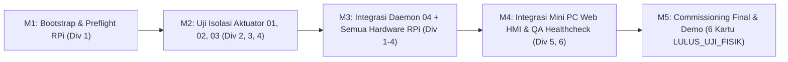

# Pemetaan Jobdesk, Ketergantungan, & Definition of Done (6 Divisi DECY-13)

Dokumen ini menjadi acuan kerja seluruh 6 divisi proyek **Alat Peraga Akselerator Siklotron DECY-13 (13 MeV H⁻)** di Politeknik Teknologi Nuklir Indonesia (BRIN), khususnya ketika anggota divisi melakukan pengujian pada unit **Raspberry Pi 3B+ yang berbeda** dari yang dipegang Ketua Tim.

---

## 1. Alur Auto-Konfigurasi, Pengumuman Tugas Baru, & Pengingat Uji untuk RPi Anggota Divisi

Jika anggota Divisi 2, 3, 4, 5, atau 6 mengetes menggunakan Raspberry Pi 3B+/4B sendiri (dengan username atau hostname apa pun, bukan hanya `pi@raspberrypi`), jalankan 2 perintah standar ini di RPi setelah menarik kode repo:

```bash
# 1. Auto-konfigurasi OS, SPI0, Audio OFF, Mosquitto (1883 & 9001), dan 6 paket Python:
bash tools/raspi_bootstrap.sh

# 2. Tampilkan pengumuman ketua, tugas baru, show perubahan kode, batas file, & ceklis Tahap B divisimu:
python3 tools/raspi_preflight.py --divisi <NOMOR_DIVISI_1_SAMPAI_6>
```

Skrip `tools/raspi_preflight.py` otomatis:
1. Menampilkan **`[0] Pengumuman Ketua & Tugas Baru Divisi`** langsung dari `tools/jobdesk_divisi.json` (`current_announcement` & `current_tasks`) beserta **`[0B] Show Perubahan Kode Saat Ini`** (`git status -sb` & `git diff --stat` terhadap `origin/main`).
2. Memeriksa kesiapan `/boot/firmware/config.txt` (`dtparam=audio=off`, `dtparam=spi=on`), `/dev/spidev0.0`, port Mosquitto `1883` & `9001`, dan ke-6 library Python.
3. Menampilkan daftar file yang boleh diedit oleh divisi tersebut (agar bebas *merge conflict*).
4. Menampilkan peringatan wiring lintas-divisi (misal *common ground* 12V/5V, konflik PWM0 audio pada GPIO 18, dan orientasi SPI0 LCD).
5. Mencetak tiap butir **Tahap B** dari kartu `laporan_uji/UJI_DIVISI_N_*.md` lengkap dengan perintah terminal yang harus dijalankan.
6. Menyimpan log preflight ke `laporan_uji/bukti/` sebagai lampiran bukti Bagian C (tanpa mencentang `[x]` secara otomatis).

---

## 2. Tabel RACI & Pembagian Tanggung Jawab 6 Divisi

Keterangan: **R** = *Responsible* (Pelaksana Eksklusif), **A** = *Accountable* (Pemeriksa/Penyetuju Merge), **C** = *Consulted* (Koordinasi Integrasi), **I** = *Informed*.

| Subsistem / Komponen | Div 1 (Core) | Div 2 (Vakum) | Div 3 (LED) | Div 4 (LCD) | Div 5 (HMI) | Div 6 (QA) |
| :--- | :---: | :---: | :---: | :---: | :---: | :---: |
| `04_decy13_mqtt_daemon.py` & `config_hardware.json` | **R / A** | C | C | C | C | C |
| `modules/base_module.py` & `modules/__init__.py` | **R / A** | I | I | I | I | I |
| `modules/mod_vacuum_safety.py` & `01_test_relay_buzzer.py` | A | **R** | I | I | I | C |
| `modules/mod_led_ws2812b.py` & `03_test_led_pixel_finder.py` | A | I | **R** | C | C | C |
| `modules/mod_lcd_ili9341.py` & `02_test_lcd_ili9341.py` | A | I | C | **R** | I | C |
| `web_hmi/index.html` (SCADA & Kanvas 2D Mini PC) | A | I | C | I | **R** | C |
| `06_test_mqtt_healthcheck.py`, Node-RED & Commissioning | A | C | C | C | C | **R** |

---

## 3. Rincian Jobdesk, Pin Hardware, & Definition of Done per Divisi

| Divisi | Penanggung Jawab & Branch | Pin BCM / Antarmuka | File Eksklusif | Definition of Done (Syarat Lulus Penuh) |
| :--- | :--- | :--- | :--- | :--- |
| **Divisi 1**<br>Core Backend & Integrator | `azfaaksan-hub`<br>`main` / `core-raspi-backend` | Loop 200 ms, MQTT `1883` & WS `9001` | `04_decy13_mqtt_daemon.py`, `05_laptop_dryrun_simulator.py`, `config_hardware.json`, `modules/base_module.py`, `modules/__init__.py`, `tools/*`, `UJI_DIVISI_1_CORE_RASPI.md` | Daemon berjalan stabil ~5 Hz di RPi 3B+, validasi input `SET_PARAMS` aktif, auto-reconnect MQTT bekerja, ketiga modul hardware `[HARDWARE AKTIF]`, dan `cleanup_all()` aman. |
| **Divisi 2**<br>Vakum, Buzzer & E-Stop | `dzakimumtazi`<br>`divisi-2-vacum-safety` | Relay Kipas: `GPIO 21` (Active-LOW)<br>Buzzer: `GPIO 17`<br>E-Stop: `GPIO 22` (Pull-Up) | `modules/mod_vacuum_safety.py`, `01_test_relay_buzzer.py`, `UJI_DIVISI_2_VAKUM_SAFETY.md` | Kipas 12V langsung OFF saat init & cleanup, menyala stabil saat vakum aktif, buzzer berbunyi sesuai 3 mode (Power 5s, Shoot beep, E-Stop 3s), dan E-Stop fisik bebas *false-trigger*. |
| **Divisi 3**<br>LED Strip WS2812B | `blufiaa`<br>`divisi-3-led-ws2812b-v13` | Data LED: `GPIO 18` (PWM0/DMA, 64 piksel: `0..47` Spiral, `48..63` Shoot) | `modules/mod_led_ws2812b.py`, `03_test_led_pixel_finder.py`, `UJI_DIVISI_3_LED_WS2812B.md` | `dtparam=audio=off` aktif, 64 piksel menyala sesuai indeks fisik, urutan warna RGB/GRB akurat, komet 40 FPS bebas *flicker* saat LCD SPI0 aktif, dan padam total saat `cleanup()`. |
| **Divisi 4**<br>LCD TFT SPI ILI9341 | `HDMrishiki` (Anggota 4)<br>`divisi-4-lcd-ili9341` | SPI0: `CE0=GPIO 8`, `MOSI=GPIO 10`, `SCLK=GPIO 11`, `DC=GPIO 24`, `RST=GPIO 25` | `modules/mod_lcd_ili9341.py`, `02_test_lcd_ili9341.py`, `UJI_DIVISI_4_LCD_ILI9341.md` | `/dev/spidev0.0` aktif, layar 320x240 menampilkan 4 baris telemetri + bar vakum & energi MeV dengan tajam dari jarak 1–2 m, dan render thread ~4 FPS tidak memblokir daemon. |
| **Divisi 5**<br>Web HMI SCADA Mini PC | `HDMrishiki` (Anggota 5)<br>`divisi-5-web-hmi` | WebSocket `ws://<IP_RPI>:9001` (`decy13/hmi/cmd` & `decy13/rpi/state`) | `web_hmi/index.html`, `web_hmi/assets/*`, `UJI_DIVISI_5_WEB_HMI.md` | Web HMI di Mini PC terhubung ke RPi (`MQTT TERHUBUNG`), seluruh tombol menggerakkan aktuator fisik, kanvas LED 2D sinkron dengan `activeLedIdx`/`shootLedIdx`, dan E-Stop fisik memicu layar merah darurat. |
| **Divisi 6**<br>MQTT QA, Node-RED & Commissioning | `rekypurnomo`<br>`divisi-6-mqtt-nodered-qa-testing` | TCP `1883`, WS `9001`, Node-RED `1880` | `06_test_mqtt_healthcheck.py`, `nodered/flows_mqtt_decy13.json`, `CHECKLIST_COMMISSIONING.txt`, `UJI_DIVISI_6_MQTT_QA.md` | Healthcheck terhadap RPi nyata mencatat ~5.0 Hz tanpa paket rusak, sekuens 7 tahap + E-Stop lulus, Node-RED berfungsi, dan `CHECKLIST_COMMISSIONING.txt` terverifikasi penuh. |

---

## 4. Urutan Milestone Penyelesaian Proyek (M1 – M5)



| Milestone | Target | Divisi Terlibat | Kriteria Lulus |
| :--- | :--- | :--- | :--- |
| **M1** | Kesiapan OS & Broker RPi | Divisi 1 (dan anggota pemegang RPi) | `bash tools/raspi_bootstrap.sh` & `python3 tools/raspi_preflight.py` lulus tanpa error. |
| **M2** | Uji Isolasi Komponen Fisik | Divisi 2, Divisi 3, Divisi 4 | `01_test_relay_buzzer.py`, `02_test_lcd_ili9341.py`, dan `03_test_led_pixel_finder.py` lulus pada komponen fisik masing-masing. |
| **M3** | Integrasi Penuh di RPi 3B+ | Divisi 1, 2, 3, 4 | `sudo python3 04_decy13_mqtt_daemon.py` menjalankan Relay, Buzzer, E-Stop, LED WS2812B, dan LCD ILI9341 secara serentak tanpa gangguan. |
| **M4** | Integrasi Ruang Kontrol Mini PC | Divisi 5, Divisi 6 | Web HMI di Mini PC mengendalikan RPi via `ws://<IP_RPI>:9001` dan `06_test_mqtt_healthcheck.py` lulus. |
| **M5** | Commissioning & Serah Terima Demo | Seluruh Divisi 1–6 | Keenam file `laporan_uji/UJI_DIVISI_1..6_*.md` berstatus `LULUS_UJI_FISIK` (Tahap A 100%, Tahap B 100%) dan `python tools/cek_integrasi_dan_announcer.py --ci` lulus. |
